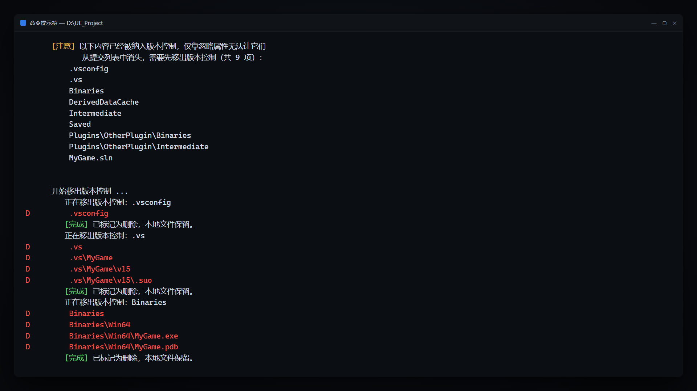
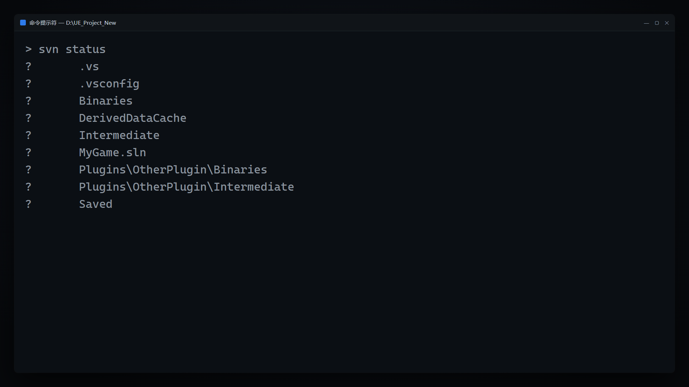
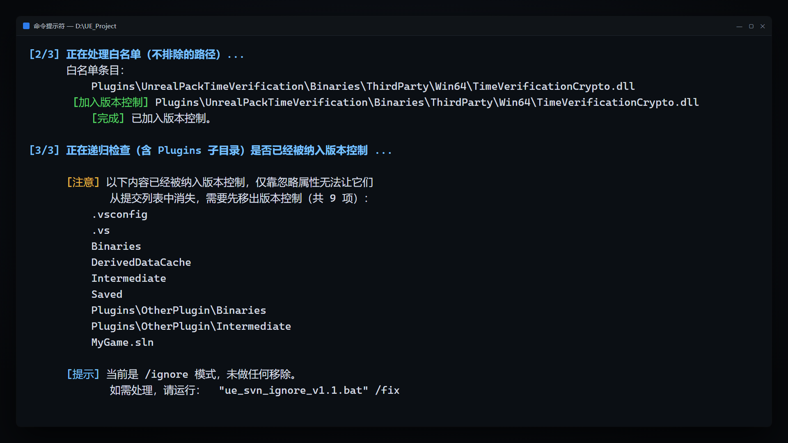
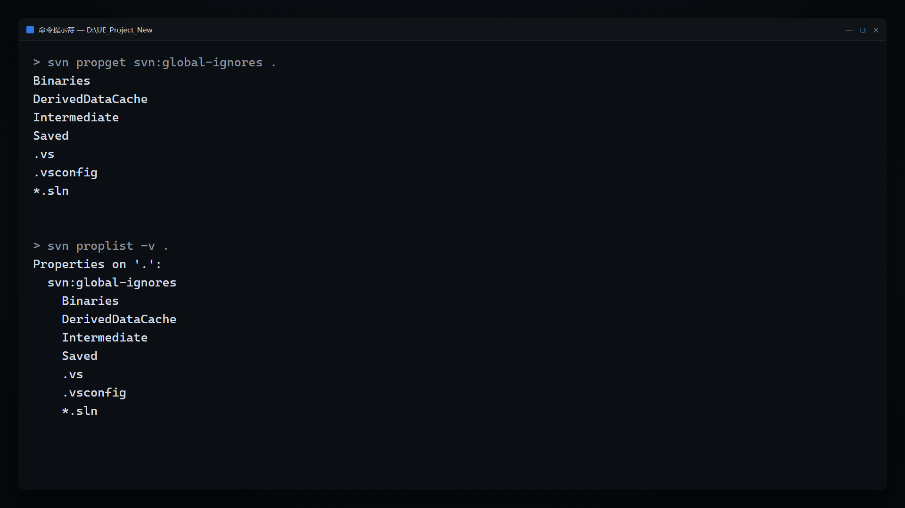
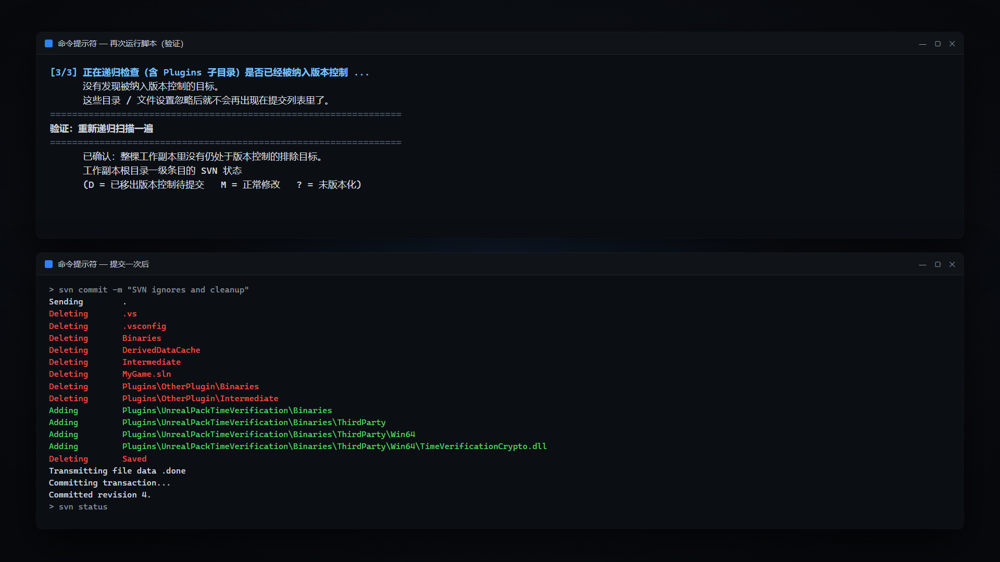
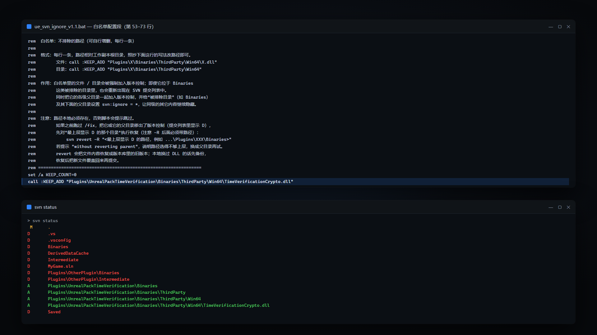
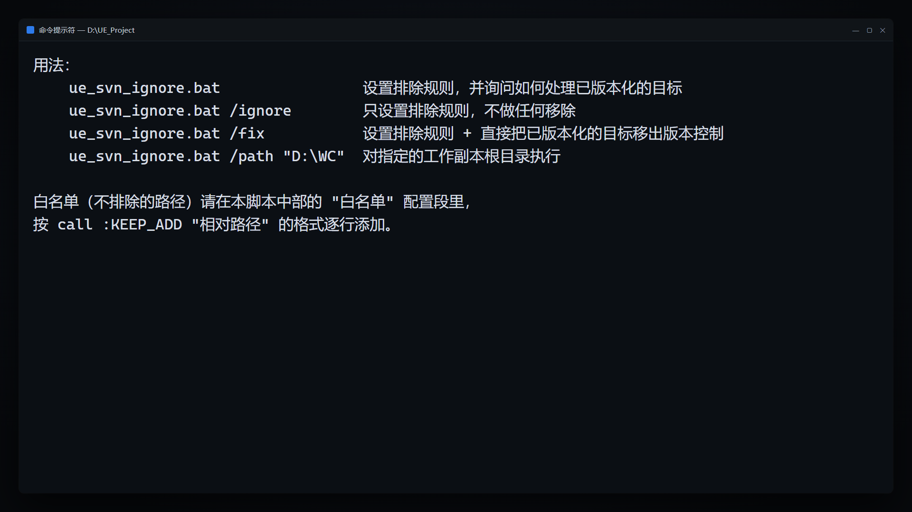

# ue_svn_ignore

一个 Windows 批处理脚本：让 Unreal Engine 工程的 SVN 提交列表里，只留下真正该提交的内容。

`ue_svn_ignore_v1.1.bat` 把 `Binaries`、`DerivedDataCache`、`Intermediate`、`Saved`、`.vs`、`.vsconfig`、`*.sln` 写进工作副本根目录的 `svn:global-ignores` 属性，让这些目标在整棵工作副本（含 `Plugins` 等子目录）里不再出现在提交列表中；对已经被误纳入版本库的内容，脚本会递归扫描出来并移出版本控制（本地文件保留）。

- 单文件脚本，双击即可运行，不需要编译或安装额外组件（只需要一个可用的 svn 命令行）
- 忽略规则写在**仓库属性**上：提交一次后全队生效，而不是只在你本机生效
- 支持白名单：`Binaries` 下需要入库的 DLL 可以单独放行
- 只标记删除、不删本地文件（`svn delete --force --keep-local`），可随时 `svn revert -R` 回滚
- 先预览后动手：`/ignore` 只设置规则，`/fix` 才移出版本控制



## 它解决什么问题

UE 工程编译、运行之后会生成大量构建产物和本地缓存。只要其中任何一项被 `svn add` 过，TortoiseSVN 的提交对话框里就会长期混着这些内容：

- 每次提交列表都很长，真正的源码、资源改动被淹没，容易误勾选
- `Binaries`、`Intermediate`、`DerivedDataCache` 动辄数百 MB 到数 GB，误提交后仓库迅速膨胀，检出和更新明显变慢
- 多台机器上的二进制文件各不相同，提交后频繁冲突，DLL/PDB 冲突几乎无法手工合并
- 有人提交、有人本地删除，工作副本状态长期"脏"，`svn status` 里一堆看不懂的项

TortoiseSVN 的"全局忽略"设置能解决自己机器上的问题，但它是本机设置、不进仓库，所以同事那边照样是脏的。本脚本把规则写进仓库属性，提交一次后所有人同步生效。

## 排除规则

脚本内置以下 7 条规则，写入工作副本根目录的 `svn:global-ignores`：

| 目标 | 类型 | 说明 |
| --- | --- | --- |
| `Binaries` | 目录 | UE 可执行文件、链接产物等二进制输出 |
| `DerivedDataCache` | 目录 | 资源派生数据缓存 |
| `Intermediate` | 目录 | 编译中间文件 |
| `Saved` | 目录 | 日志、配置、崩溃报告等运行时数据 |
| `.vs` | 目录 | Visual Studio 用户缓存 |
| `.vsconfig` | 文件 | VS 组件清单（脚本第 3 步只检查工作副本根目录的这一个文件） |
| `*.sln` | 文件通配 | 解决方案文件 |

规则固定写在脚本第 1 步里。如需增删，直接改脚本中的规则列表；若增删的是目录名，还要同步改三处：第 1 步的规则列表、`:IS_EXCLUDED_NAME` 段（白名单判断"哪一级目录是被排除目录"用）、第 3 步 `:COLLECT` 里的 `findstr` 过滤条件（递归扫描用）。

## 功能特性

- 内置 7 条排除规则，写一次覆盖整棵工作副本
- 三种运行模式：默认询问（ask）、`/ignore` 只写规则、`/fix` 直接移出；另有 `/path` 指定工作副本
- 自动用 `svn info --show-item wc-root` 定位真正的工作副本根目录，脚本放在子目录里也能用
- 第 3 步递归扫描整棵工作副本（包括 `Plugins` 下的同名目录和 `*.sln`），不只看根目录
- 白名单机制：指定路径强制纳入版本控制，并把相关父目录登记为受保护，清理阶段不会误删
- 清理前后各扫描一次（第 3 步收集 + 验证阶段复查），输出遗留清单和工作副本根目录的 `svn status`
- 自动切到代码页 936，结束时恢复原代码页；启动命令行里带脚本名时（如双击）自动 `pause`，方便看输出
- 不做任何自动提交：所有改动都由你在 TortoiseSVN 或命令行里确认后提交

## 工作原理

1. **递归排除**：脚本把 7 条规则写进工作副本根目录的 `svn:global-ignores` 属性。SVN 1.8 及以上会让该属性被所有子目录继承，因此等价于"整棵工作副本递归忽略"。TortoiseSVN 的提交对话框和 `svn status` 都会自动跳过未纳入版本控制的目标。
2. **已版本化的目标必须移出**：忽略属性只对"未纳入版本控制"的内容有效，已经提交过的东西照样显示 `A`/`M`/`D`。所以第 3 步会递归找出它们，执行 `svn delete --force --keep-local`——本地文件原样保留，只在本地把该路径标记为"待删除"（`D`）。
3. **白名单补丁**：白名单里的文件/目录即使位于 `Binaries` 这类被排除的目录下，也会被强制 `svn add --no-ignore` 纳入版本控制；同时脚本给最上层被排除目录（如 `Binaries`）以及它到该文件之间的各级目录补 `svn:ignore = *`，让同级的其它内容继续隐藏，并在第 3 步跳过这些受保护路径，避免把要提交的 DLL 删掉。
4. **提交一次才生效**：属性改动和删除标记都只存在于本地工作副本，需要提交一次才会进入仓库并同步给其他人；提交前，本地的 TortoiseSVN 提交列表已经按新规则显示了。

## 已知限制

- 只处理上面表里的 7 类目标，其它目录名、文件类型不会被动到
- 只修改本地工作副本，不直接改服务器；规则和删除都要靠提交生效
- 不负责自动提交，也不做 `svn update`、锁定、冲突解决
- 忽略属性只对未纳入版本控制的内容有效，已提交内容必须先移出再提交
- 仅支持 Windows（`.bat` + `chcp 936`）
- `svn:global-ignores` 需要 SVN 1.8 及以上；脚本还用到 `svn info --show-item wc-root`（SVN 1.9+），所以整体建议使用 SVN 1.9 及以上客户端
- 第 3 步对 `.vsconfig` 只检查工作副本根目录，不递归扫描子目录里的同名文件

## 环境要求

- Windows 10 / 11，使用 `cmd` 运行（脚本是 `.bat`）
- TortoiseSVN 1.10+（安装时勾选 **command line client tools**），或 Apache Subversion 命令行版（1.9+；脚本用到 `svn info --show-item`）
- `svn.exe` 在 `PATH` 中，命令行执行 `svn --version` 能正常输出
- 目标目录是 SVN 工作副本（目录里有 `.svn`），最好是工作副本根目录
- 属性 `svn:global-ignores` 需要 SVN 1.8 及以上

## 快速开始

1. **获取脚本**：克隆或下载本仓库，拿到 `ue_svn_ignore_v1.1.bat`。
2. **放置脚本**：复制到 UE 工程根目录（`.uproject`、`.sln` 所在目录）；也可以放在任意位置，运行时用 `/path` 指定工程路径。
3. **先预览**：运行 `/ignore` 模式。它只写排除规则、不移出任何目标（白名单里尚未入库的条目仍会被加入版本控制），同时会列出“已被纳入版本控制”的目标，先看看清单里有没有你不想动的东西。
4. **再修复**：确认清单没问题后运行 `/fix` 模式。
5. **提交**：用 TortoiseSVN 提交这次改动（至少包含工作副本根目录的属性改动，以及列表里状态为 `D` 的项）。提交后同事 `update` 一次即可生效。
6. **刷新**：在 TortoiseSVN 里按 `F5` 刷新，提交列表里这些内容就消失了。

在 `cmd` 里运行：

```bat
cd /d D:\UEProject
ue_svn_ignore_v1.1.bat /ignore
ue_svn_ignore_v1.1.bat /fix
```

在 PowerShell 里运行：

```powershell
Set-Location D:\UEProject
& '.\ue_svn_ignore_v1.1.bat' /ignore
& '.\ue_svn_ignore_v1.1.bat' /fix
```

> 提示：`pause` 是否触发取决于启动命令行里是否带脚本名。双击、PowerShell 的 `&` 调用、`cmd /c "脚本.bat"` 都会带脚本名，结束时需要按一次键；在已打开的 cmd 窗口里直接输入脚本名则不会。

脚本不在工程根目录时，用 `/path` 指定工作副本根目录：

```bat
ue_svn_ignore_v1.1.bat /path "D:\UEProject" /ignore
```

也可以直接双击运行。双击时脚本默认使用 ask 模式，会列出已被纳入版本控制的目标并询问：

```
[注意] 以下内容已经被纳入版本控制，仅靠忽略属性无法让它们
       从提交列表中消失，需要先移出版本控制（共 N 项）：
       ...
是否把它们移出版本控制？本地文件会完整保留，提交一次后生效。
请输入 Y 确认，直接回车跳过：
```

输入 `Y`（不区分大小写）才会执行移出，直接回车则跳过、只保留排除规则。

## 参数与模式

| 模式 | 命令 | 行为 | 适用场景 |
| --- | --- | --- | --- |
| 默认（ask） | `ue_svn_ignore_v1.1.bat` | 设置排除规则；发现已被纳入版本控制的目标时列出清单并询问，输入 `Y` 才移出，直接回车跳过 | 首次使用、想逐次确认 |
| 只忽略 | `ue_svn_ignore_v1.1.bat /ignore` | 写入排除规则并处理白名单；绝不删除或移出任何已版本化目标 | 正式修复前预演；确认会被加入的白名单条目 |
| 修复 | `ue_svn_ignore_v1.1.bat /fix` | 设置排除规则，并把已被纳入版本控制的目标直接移出版本控制（本地文件保留） | 确认清单没问题后的正式修复 |
| 指定路径 | `ue_svn_ignore_v1.1.bat /path "D:\WC"` | 对指定的工作副本根目录执行，可与 `/ignore`、`/fix` 组合 | 脚本不在工程根目录 |
| 帮助 | `ue_svn_ignore_v1.1.bat /?` | 打印用法说明 | 忘记参数时 |

参数不区分大小写。传入无法识别的参数时，脚本会打印 `[错误] 无法识别的参数：...`，然后显示用法。

## 三步处理流程

脚本运行时按 `[1/3]`、`[2/3]`、`[3/3]` 打印进度。

### 第 1 步（1/3）：写入递归排除规则

- 把 7 条规则写入临时文件，执行 `svn propset svn:global-ignores --file "<临时文件>" "<工作副本根目录>"`
- 成功后用 `svn propget svn:global-ignores` 回显当前属性内容，方便核对
- 失败则打印 `[错误] 设置 svn:global-ignores 失败，请检查上面的报错信息。` 并退出
- 属性只改本地工作副本，提交后才同步给其他人

### 第 2 步（2/3）：处理白名单

- 没有配置白名单时打印"未配置白名单，跳过。"
- 逐条处理白名单（配置方法见下一节），对每条路径：
  - 本地不存在 → 提示跳过
  - 未纳入版本控制 → `svn add --no-ignore --parents --force` 强制加入
  - 已纳入版本控制 → 跳过
  - 已被移出版本控制（调度状态为 `delete`，即提交列表里显示 `D`）→ 报错，并提示应对"最上层显示 D 的路径"执行 revert
- 同时把该路径的各级父目录、最上层被排除目录（如 `Binaries`）登记为"受保护"；并给最上层被排除目录本身、以及它到该文件之间的各级目录补 `svn:ignore = *`（已有 `*` 时不重复设置），让同级其它内容继续隐藏。注意：只有路径位于被排除目录（`Binaries` 等）之下时才会补；工作副本根目录下的 `*.sln` 白名单没有这一层父目录，不会设置 `svn:ignore = *`
- 有处理失败的条目时，最后汇总一条 `[警告]`，提示按上面的提示手动处理

### 第 3 步（3/3）：处理已被纳入版本控制的目标

- **收集**：先检查工作副本根目录的 `.vsconfig`；再用 `dir /s /b /ad` 递归列出整棵工作副本的目录并用 `findstr` 过滤出名为 `Binaries`、`DerivedDataCache`、`Intermediate`、`Saved`、`.vs` 的目录；然后用 `dir /s /b /a-d` 递归找出所有 `*.sln`
- **判定**：对每个候选项执行 `svn info`，未纳入版本控制的直接忽略；已经处于待删除状态（`schedule=delete`）的跳过；命中白名单保护列表的跳过
- **移出**：对其余目标执行 `svn delete --force --keep-local`，标记为删除、本地文件保留；失败则计数并在最后提示手动处理
- 默认 ask 模式会先列出清单并询问；`/ignore` 模式只列清单不移出，并提示改用 `/fix`；`/fix` 直接移出

### 验证与结束

- 重新递归扫描一遍，输出是否还有遗留目标
- 打印工作副本根目录一级条目的 `svn status --depth=immediates`，并说明状态含义：`D` = 已移出版本控制待提交，`M` = 正常修改，`?` = 未版本化
- 最后提示两件事：属性改动本身也需要提交一次才会同步给其他人；在 TortoiseSVN 里按 `F5` 刷新后这些内容就不会出现在提交列表中了
- 恢复运行前的代码页；启动命令行里带脚本名时（如双击）在结束前 `pause`，方便查看输出

## 白名单配置

### 位置与格式

白名单在脚本中部的"白名单配置段"里维护，位于 `set /a KEEP_COUNT=0` 之后，每行一条：

```bat
set /a KEEP_COUNT=0
call :KEEP_ADD "Plugins\UnrealPackTimeVerification\Binaries\ThirdParty\Win64\TimeVerificationCrypto.dll"
```

- 路径相对**工作副本根目录**，用反斜杠分隔；也可以写绝对路径
- 文件、目录都可以，例如目录：`call :KEEP_ADD "Plugins\X\Binaries\ThirdParty\Win64"`
- 脚本自带的示例条目仅用于演示格式，请改成自己工程里真实存在的路径

### 生效机制

对每个白名单条目，脚本会：

1. 把该路径及其各级父目录、直到最上层的被排除目录（如 `Binaries`），登记为"受保护"路径；
2. 未纳入版本控制的，用 `svn add --no-ignore --parents --force` 强制加入（`--no-ignore` 让它无视上面的忽略规则，`--parents` 自动把父目录一并加入）；
3. 给最上层被排除目录本身、以及它到白名单文件之间的各级目录补 `svn:ignore = *`，让同级的其它内容继续被隐藏（工作副本根目录下的 `*.sln` 白名单没有被排除目录父层级，不会补）；
4. 第 3 步扫描时跳过受保护路径，因此白名单里的 DLL 不会被误删。

### 常见陷阱

- **路径写错或本地不存在**：脚本只提示"白名单路径本地不存在，跳过"，不会报错退出，容易误以为已生效。
- **白名单路径显示 D**：说明之前跑过 `/fix` 把它（或它的父目录）移出了版本控制。先对它最上层显示 `D` 的目录执行恢复：`svn revert -R "<最上层显示 D 的路径>"`，然后重新运行脚本。
- **`-R` 后面必须带路径**：脚本给出的恢复命令形式是 `svn revert -R "<路径>"`，请显式写出要恢复的路径。
- **白名单写目录会连内容一起加入**：`svn add` 对目录是递归的，写目录会把该目录下所有文件（包括原本被忽略的）一起纳入版本控制；只想要单个文件就写文件路径。
- **本地换过 DLL 时先备份**：revert 会把文件内容恢复成版本库里的旧版本。先备份你本地的新 DLL，revert 之后再把新文件覆盖回来并提交。
- **改完白名单要重新运行脚本**：白名单只在脚本运行时读取，改完保存后重跑一次才会生效。

## 已经提交进版本库的内容为什么必须移出

SVN 的忽略规则只作用于"未纳入版本控制"的路径。一个目录或文件一旦被 `svn add` 并提交进仓库，它就已经是版本控制对象了，忽略属性对它没有任何作用——提交列表里照样是 `M`/`A`/`D`。

所以脚本对这类目标的处理是"移出版本控制"：`svn delete --force --keep-local` 只在本地把路径标记为待删除（`D`），磁盘上的文件、目录原样保留。提交这次删除后，它们才会真正从仓库里消失——执行脚本的这台机器上文件仍在，本地目录里只是不再被 SVN 跟踪；其他同事提交/更新时的表现由 SVN 的删除语义决定。这就是"提交一次才真正生效"的含义。

## 回滚与恢复

想撤销 `/fix` 造成的移出，对**最上层显示 D 的路径**执行递归恢复：

```bat
svn revert -R "D:\UEProject\Plugins\XXX\Binaries"
```

- `-R` 后必须带路径。提示 `without reverting parent` 说明路径选得不够上层，换成它的父目录再试。
- revert 会把文件内容恢复成版本库里的旧版本；如果你本地换过 DLL，请先备份，恢复后把新文件覆盖回来再提交。
- 注意不要直接 revert 工作副本根目录：根目录上挂着第 1 步写入的 `svn:global-ignores` 属性改动，一起撤销会把排除规则也回滚掉。
- 恢复之后如果还要继续用排除规则，先把需要保留的路径加进白名单，再重新运行脚本，避免它又被第 3 步移出。

## 编码说明

脚本开头有明确注释：**本文件必须保存为 ANSI / GBK（代码页 936）编码，否则中文会乱码；不要用 UTF-8 保存**。原因是 `cmd` 按当前代码页解析批处理文件，UTF-8 编码的中文注释和 `echo` 输出会被解释成乱码，甚至导致解析错误。

脚本自身做了两件事：

- 开头 `chcp 936`，把控制台切到简体中文代码页，保证中文输出正常；
- 结束时恢复运行前的代码页（`chcp %OLDCP%`），不污染当前命令行窗口。

改动脚本后的正确保存方式：

- VS Code：右下角编码 → `Save with Encoding` → 选择 `GBK`（或 `936`）
- Notepad++：`编码` → `转为 ANSI`

另外，仓库里的文件名带版本号（`ue_svn_ignore_v1.1.bat`）；`/?` 帮助文字里写的是不带版本号的 `ue_svn_ignore.bat`，`/ignore` 模式结尾的提示则显示实际运行的脚本名。两种情况下都以实际文件名为准。

## 常见问题 FAQ

### 1. 双击运行后中文乱码，或者窗口一闪而过

乱码通常是脚本被存成了 UTF-8：用编辑器另存为 ANSI/GBK。`pause` 是否触发取决于启动命令行里是否带脚本名：双击必然暂停（能看到报错和结果）；PowerShell 里用 `&` 调用同样带脚本名、也会暂停；只有在已打开的 cmd 窗口里直接输入脚本名运行才不暂停。如果窗口确实一闪而过，请在 cmd 窗口里运行（`ue_svn_ignore_v1.1.bat`）查看输出。

### 2. 提示 `[错误] 未找到 svn.exe`

说明 `svn.exe` 不在 `PATH` 中。安装 TortoiseSVN 时勾选 **command line client tools**（默认不勾选），或安装 Apache Subversion 命令行版，并把 `svn.exe` 所在目录加入 `PATH`；改完 `PATH` 后需要重开命令行窗口。

### 3. 提示 `[错误] 这个目录不是 SVN 工作副本`

脚本要求目标目录（或它的上级）是 SVN 工作副本。把 bat 放到 UE 工程根目录（里面有 `.svn`）再运行，或用 `/path` 指定工作副本根目录。脚本会自动用 `svn info --show-item wc-root` 找到真正的根目录，如果目标不是根目录会提示并自动切换。

### 4. 运行完了，TortoiseSVN 提交列表里还是有这些东西

先按 `F5` 刷新。仍然存在的话，通常是因为这些内容已经被纳入版本控制——忽略对它们无效，需要用 `/fix` 移出并提交。可以用 `svn propget svn:global-ignores "<工作副本根目录>"` 确认属性已写入，再用 `svn status` 查看目标当前的实际状态。

### 5. `/fix` 之后提交列表里出现一堆 `D`

这是预期行为：`D` = 已移出版本控制、待提交，本地文件还在。提交这次删除后，这些目标才会从仓库中消失。想反悔就执行上一节的 `svn revert -R`。

### 6. 我提交了属性，同事那边为什么没变化

属性和删除都只在本地工作副本生效，需要提交进仓库，同事再 `update` 一次才会同步。只提交代码、没提交根目录的属性改动，别人那边不会有任何变化。

### 7. `*.sln` 被排除了，但我需要提交某个 sln

把该 `.sln` 的相对路径加进白名单。脚本会把它登记为受保护路径，第 3 步不会把它移出版本控制；如果它还没入库，还会被 `svn add --no-ignore` 强制加入。

### 8. 白名单里的 DLL 加不进去，提示显示 D

说明它或它的父目录之前被 `/fix` 移出了版本控制。对最上层显示 `D` 的路径执行 `svn revert -R "<路径>"`，再重新运行脚本。别忘了 revert 会把内容恢复成仓库里的旧版本，本地换过 DLL 要先备份。

### 9. 忽略规则对某个目录就是不生效

排查顺序：① 确认目录名是否属于脚本的 7 条规则；② 用 `svn info "<目录>"` 看它是否已经被纳入版本控制，已被纳入的忽略无效，需要用 `/fix` 移出并提交；③ 用 `svn propget svn:global-ignores "<工作副本根目录>"` 确认属性已写入，并在 TortoiseSVN 里按 `F5` 刷新。

### 10. 脚本会自动提交吗

不会。脚本只修改本地工作副本的属性和版本控制状态，提交需要你在 TortoiseSVN 或 `svn commit` 里自己确认执行。

### 11. 我想排除其它目录名，改哪里

三处：第 1 步的规则列表、`:IS_EXCLUDED_NAME` 段里的目录名判断（白名单用）、第 3 步 `:COLLECT` 里的 `findstr` 过滤条件（递归扫描用）。漏改任一处，新增目录都不会被完整忽略/移出。

## 目录结构

```
ue_svn_ignore/
├── README.md                  # 本文件
├── ue_svn_ignore_v1.1.bat     # 工具主体（ANSI/GBK 编码，约 16 KB）
├── docs/
│   └── screenshots/           # README 中引用的截图
│       ├── 01-before-status.png
│       ├── 02-ignore-mode.png
│       ├── 03-fix-mode.png
│       ├── 04-properties.png
│       ├── 05-verify-clean.png
│       ├── 06-whitelist.png
│       └── 07-usage.png
└── video/                     # 演示视频素材
    ├── 视频文案.md            # 60–90 秒快剪 + 3–5 分钟详细版分镜、口播稿
    ├── 提示词.md              # AI 生图 / 生视频 / TTS 提示词
    └── 封面.png               # 16:9 封面图（1920×1080）
```

运行时只依赖 `ue_svn_ignore_v1.1.bat` 一个文件，`docs/`、`video/` 仅用于文档与演示，不参与脚本运行。

## 截图

> 以下截图来自本地演示工作副本里的真实运行输出（终端样式渲染）；其中 05、06 是两张真实输出的上下拼接图。

### 1. 修复前：`svn status` 里一堆未版本化的构建产物



### 2. `/ignore` 模式：写入规则、处理白名单并列出已版本化目标



### 3. `/fix` 模式：把已版本化目标移出版本控制


### 4. 工作副本根目录的 `svn:global-ignores` 属性



### 5. 验证与提交：再扫描一次，提交后 `svn status` 为空



### 6. 白名单：让 Binaries 下的 DLL 继续入库



### 7. `/?` 用法帮助



## 版本说明

- 当前版本：**v1.1**，仓库内文件名为 `ue_svn_ignore_v1.1.bat`；`/?` 帮助文字写作 `ue_svn_ignore.bat`（不带版本号），运行时以实际文件名为准
- 本仓库暂未维护变更历史；后续版本可以用 git tag（如 `v1.2`）标记，并在本节补充变更内容

## 免责声明与许可证

- 脚本会修改工作副本的 SVN 属性；在 ask 模式确认输入 `Y` 或使用 `/fix` 时，还会执行 `svn delete --force --keep-local` 改变版本控制状态（磁盘文件不会被删除，但需要提交才最终生效）。
- 首次使用建议先用 `/ignore` 预览，并先备份工作副本（至少备份白名单涉及的文件），再执行 `/fix`。
- 脚本不负责提交，也不校验你的提交内容；提交前请自行检查提交列表。
- 本仓库未附开源许可证。团队内部可直接使用；团队外使用、分发或二次发布前，请先与作者确认授权。

## 反馈

使用中遇到问题或有改进建议，欢迎在仓库提交 Issue，并附上脚本的完整输出、`svn --version` 的结果和操作系统版本。
